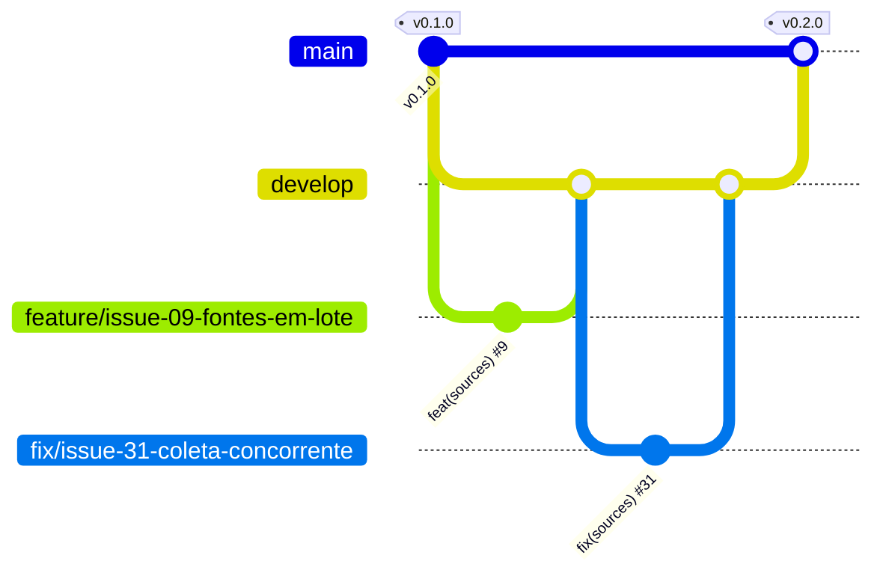

<p align="center">
  
</p>

# JobFly

> Language: [Português](README.md) | **English** | [Español](README.es.md)

[](https://github.com/thaynabds/JobFly/releases/tag/v0.2.0)
[](#license)
[](https://github.com/thaynabds/JobFly/actions/workflows/ci.yml)
[](#quality-and-security)
[](src/jobfly-api)
[](src/jobfly-api)
[](src/jobfly-web)

**A career management and job application automation platform for jobs and internships, in Brazil and abroad.**

**Author:** [Thayná Batista da Silva](https://github.com/thaynabds) · **Repository:** private · **Version:** 0.2.0

## The problem

People looking for tech jobs apply through many channels at once: LinkedIn, Gupy, Greenhouse, company websites, Instagram posts, Facebook groups, email and referrals. Each channel reports progress (or doesn't) in its own way. The result: matching jobs slip by, processes are forgotten, and applications go out without understanding the requirements.

JobFly brings it all into one explainable hub:
- it **watches** websites, ATSs and social networks, many at once and for several profiles;
- it **analyzes** how each job matches each profile, showing the reason for every requirement;
- it **tracks** every application, from any origin, based on evidence;
- it **shows** what needs your attention.

## Features

### Implemented (v0.2.0)

| Area | What it does |
|---|---|
| Accounts | Sign-up and login with Argon2id, 15-minute sessions renewed by a rotating refresh token (everything is revoked if it is stolen), lockout after failed attempts |
| Profiles | Several independent profiles with skills (level and years), CEFR languages, history, work modes, locations, salary expectation and restrictions |
| Watched sources | Create and edit **in bulk**, each source linked to **one or more profiles**. **Automatic collection** through the public APIs of Greenhouse, Lever, SmartRecruiters and Ashby, with a background scheduler, backoff after failures, history and one collection at a time. **Reminders** for LinkedIn, Instagram, Facebook, Gupy and other platforms that do not allow automated collection |
| Jobs | Manual entry or collection, deduplicated by canonical URL and by company, title and location. Technologies mentioned in the description become requirements |
| Match | 0–100 score with the reason for each requirement. Eliminatory blockers (work mode, city, language, seniority) kept apart from the score. APPLY only when every mandatory requirement is met. Automatic choice of the best profile |
| Applications | A hub for applications from any origin, with 19 stages. Every change records source, evidence and confidence. Uncertainty becomes a suggestion. Silence never becomes a rejection. No duplicates |
| Web dashboard | Overview, to-do center with direct actions, filtered Kanban, detail with history, profiles, sources and jobs, in Portuguese and English |
| Operations | One command starts database, API and dashboard, on 127.0.0.1 only. Smoke and real collection tests. CI on GitHub Actions |

### Planned

| Next | Description |
|---|---|
| Gmail and Outlook | OAuth with minimal scopes, message classification, linking to the application and authorized replies. It never deletes email |
| AI agents | Analysis of eliminatory form questions, application review before submission and tailored documents using only real data |
| MCP and extension | MCP server with controlled permissions and a "Send to JobFly" browser extension |
| Documents | Versioned résumés, attachments and CSV history import |

The status of each requirement is in [docs/requisitos.md](docs/requisitos.md) and the order of the next deliveries in [docs/roadmap.md](docs/roadmap.md) (in Portuguese).

## Documentation

| Document | Contents |
|---|---|
| [Project charter](docs/project-charter.md) | Rationale, vision, SMART goals, scope, stakeholders and audience |
| [Requirements](docs/requisitos.md) | Numbered, traceable functional and non-functional requirements and business rules |
| [Use cases](docs/casos-de-uso.md) | Actors and main, alternative and exception flows |
| [User stories](docs/user-stories.md) | Stories with Gherkin acceptance criteria |
| [Diagrams](docs/diagramas.md) | C4 (context, containers, components), classes, ERD and state machine |
| [Architecture](docs/arquitetura.md) | Decisions (ADRs) and rationale |
| [Data model](docs/modelo-dados.md) | Tables, deduplication, states and retention |
| [API](docs/api.md) | REST API v1 reference |
| [Security](docs/seguranca.md) | Threat model, controls and tests |
| [Integrations](docs/integracoes.md) | What each platform allows and how |
| [Roadmap](docs/roadmap.md) | Status and next deliveries |
| [JobCopilot study](docs/referencias-jobcopilot/matriz-funcionalidades.md) | Feature comparison matrix |

## Running it

Requirements: **Java 21**, **Node 20.19+** and **PostgreSQL 14+** installed. PostgreSQL only needs the programs: no setup and no sudo.

```bash
# 1. Once: creates a PostgreSQL of your own in data/postgres (127.0.0.1:5433)
#    and writes .env with random passwords and JWT secret (permission 600)
scripts/configurar-local.sh

# 2. Starts database, API and dashboard
scripts/iniciar.sh
```

Open **http://127.0.0.1:5173**, create your account and start with profiles and watched sources. To stop everything: `scripts/iniciar.sh parar`.

Checks:

```bash
cd src/jobfly-api && ./mvnw verify        # API tests and 80% minimum coverage
cd src/jobfly-web && npm run verify       # dashboard types, tests and build
python3 scripts/testar-api.py             # full flow against the running API
python3 scripts/testar-coleta.py          # real collection from a public Greenhouse board
```

Environment variables are listed in [.env.example](.env.example). To use the system PostgreSQL (port 5432): `scripts/configurar-local.sh --sistema`.

## Architecture and structure

A modular monolith in Java 21 + Spring Boot 4.1 (PostgreSQL, Flyway) and a dashboard in React 19 + TypeScript + Vite 7. Modules are split by responsibility and can become separate services when there is a reason to ([ADRs](docs/arquitetura.md)).

```
JobFly/
├── docs/                 documentation (charter, requirements, use cases, stories, diagrams...)
├── src/
│   ├── jobfly-api/       REST API (Spring Boot): identity, profiles, jobs, matching, applications, sources, dashboard
│   └── jobfly-web/       web dashboard (React + TypeScript)
├── scripts/              setup, run, smoke tests and gate verifiers
├── .github/workflows/    continuous integration
├── AGENTS.md             rules for coding agents (OpenCode)
└── opencode.json         restrictive OpenCode configuration
```

## Branch flow (Git Flow)

| Branch | Purpose | Receives from | Rule |
|---|---|---|---|
| `main` | Production: only tagged stable versions | `develop`, through a release PR | Never takes direct commits. Each release gets an annotated SemVer tag (`v0.1.0`, `v0.2.0`) |
| `develop` | Integration of finished work | `feature/*` and `fix/*`, through PRs | Every PR references its issue with `Closes #N` |
| `feature/issue-NN-description` | One feature, documentation or tooling issue | branches off `develop` | Atomic Conventional Commits: `feat(sources): ... (#9)` |
| `fix/issue-NN-description` | Fix for a defect recorded in an issue | branches off `develop` | `fix(scope): ... (#31)` |



The full backlog is in the [repository issues](https://github.com/thaynabds/JobFly/issues).

## Quality and security

- **128 automated tests**: 108 in the API (unit and full-application integration tests) and 20 in the dashboard, plus 26 smoke-test checks and the real collection test.
- **Coverage:** the build fails below 80% line coverage in critical modules. Overall coverage is 94.3% today.
- **Security** ([details](docs/seguranca.md)):
  - per-user isolation (someone else's resource returns 404);
  - Argon2id and rotating refresh tokens with reuse detection;
  - protection against CSRF, XSS, SQL injection and SSRF;
  - rate and request-size limits;
  - CSP in the dashboard;
  - services on 127.0.0.1 only;
  - secrets kept out of Git;
  - 0 known vulnerabilities in the dashboard dependencies (`npm audit`).

## License

All rights reserved. Private repository.
