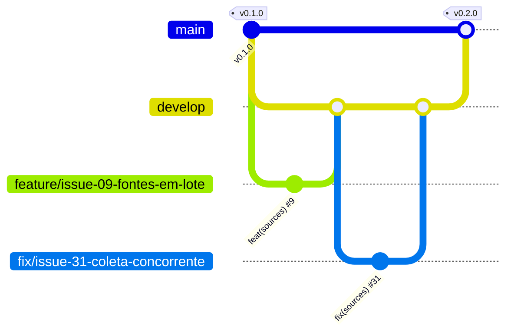

<p align="center">
  
</p>

# JobFly

> Idioma: [Português](README.md) | [English](README.en.md) | **Español**

[](https://github.com/thaynabds/JobFly/releases/tag/v0.2.0)
[](#licencia)
[](https://github.com/thaynabds/JobFly/actions/workflows/ci.yml)
[](#calidad-y-seguridad)
[](src/jobfly-api)
[](src/jobfly-api)
[](src/jobfly-web)

**Plataforma de gestión de carrera y automatización de postulaciones a empleos y prácticas, en Brasil y en el exterior.**

**Autora:** [Thayná Batista da Silva](https://github.com/thaynabds) · **Repositorio:** privado · **Versión:** 0.2.0

## El problema

Quien busca empleo en tecnología se postula por muchos canales a la vez: LinkedIn, Gupy, Greenhouse, sitios de empresas, publicaciones en Instagram, grupos de Facebook, correo y recomendaciones. Cada canal avisa (o no) el avance a su manera. El resultado: vacantes compatibles que pasan desapercibidas, procesos olvidados y postulaciones hechas sin entender los requisitos.

JobFly lo reúne todo en una central única y explicable:
- **vigila** sitios, ATS y redes sociales, muchos a la vez y para varios perfiles;
- **analiza** la compatibilidad de cada vacante con cada perfil, mostrando el motivo de cada requisito;
- **acompaña** todas las postulaciones, de cualquier origen, según la evidencia;
- **muestra** lo que depende de ti.

## Funcionalidades

### Implementado (v0.2.0)

| Área | Qué hace |
|---|---|
| Cuentas | Registro e inicio de sesión con Argon2id, sesión de 15 minutos renovada por un token rotativo (se revoca todo si lo roban), bloqueo tras intentos fallidos |
| Perfiles | Varios perfiles independientes con competencias (nivel y años), idiomas MCER, historial, modalidades, ubicaciones, pretensión y restricciones |
| Fuentes vigiladas | Alta y edición **en lote**, cada fuente vinculada a **uno o más perfiles**. **Recolección automática** por las APIs públicas de Greenhouse, Lever, SmartRecruiters y Ashby, con planificador en segundo plano, espera progresiva tras fallos, historial y una recolección a la vez. **Recordatorios** para LinkedIn, Instagram, Facebook, Gupy y otras plataformas que no permiten recolección automática |
| Vacantes | Alta manual o por recolección, sin duplicados por URL canónica y por empresa, cargo y ubicación. Las tecnologías citadas en la descripción se vuelven requisitos |
| Compatibilidad | Puntuación de 0 a 100 con el motivo de cada requisito. Impedimentos eliminatorios (modalidad, ciudad, idioma, seniority) separados de la nota. APPLY solo con todos los obligatorios cumplidos. Elección automática del mejor perfil |
| Postulaciones | Central de postulaciones de cualquier origen, con 19 etapas. Cada cambio registra origen, evidencia y confianza. La duda se vuelve sugerencia. El silencio nunca se vuelve rechazo. Sin duplicados |
| Avisos | La API genera avisos para cambios de etapa hechos por correo, agente o sistema, acciones requeridas, pruebas técnicas, recordatorios de entrevista y plazo con antelación configurable, sugerencias, fuentes con falla o por revisar, postulaciones sin actualización y vacantes nuevas por fuente (con nota mínima). Configuración por etapa, tipo y fuente (activado, ventana emergente, sistema, sonido), horario de silencio en la zona horaria de la cuenta, posponer y marcar como leído, sin repetir avisos |
| Panel web | Resumen, central de pendientes con acción directa, Kanban con filtros, detalle con historial, perfiles, fuentes y vacantes, en portugués e inglés |
| Operación | Un comando levanta la base, la API y el panel, solo en 127.0.0.1. Pruebas de humo y de recolección real. CI en GitHub Actions |

### Planificado

| Próximo | Descripción |
|---|---|
| Gmail y Outlook | OAuth con permisos mínimos, clasificación de mensajes, vínculo con la postulación y respuestas autorizadas. Nunca borra correos |
| Agentes de IA | Análisis de preguntas eliminatorias, revisión de la postulación antes del envío y documentos personalizados solo con datos reales |
| MCP y extensión | Servidor MCP con permisos controlados y extensión de navegador "Enviar a JobFly" |
| Documentos | Currículums versionados, adjuntos e importación de historial en CSV |

El estado de cada requisito está en [docs/requisitos.md](docs/requisitos.md) y el orden de las próximas entregas en [docs/roadmap.md](docs/roadmap.md) (en portugués).

## Documentación

| Documento | Contenido |
|---|---|
| [Acta de constitución](docs/project-charter.md) | Justificación, visión, objetivos SMART, alcance, stakeholders y público |
| [Requisitos](docs/requisitos.md) | RF y RNF numerados y trazables, y reglas de negocio |
| [Casos de uso](docs/casos-de-uso.md) | Actores y flujos principal, alternativos y de excepción |
| [Historias de usuario](docs/user-stories.md) | Historias con criterios de aceptación en Gherkin |
| [Diagramas](docs/diagramas.md) | C4 (contexto, contenedores, componentes), clases, DER y máquina de estados |
| [Arquitectura](docs/arquitetura.md) | Decisiones (ADR) y justificación |
| [Modelo de datos](docs/modelo-dados.md) | Tablas, deduplicación, estados y retención |
| [API](docs/api.md) | Referencia de la API REST v1 |
| [Seguridad](docs/seguranca.md) | Modelo de amenazas, controles y pruebas |
| [Integraciones](docs/integracoes.md) | Qué permite cada plataforma y cómo |
| [Roadmap](docs/roadmap.md) | Estado y próximas entregas |
| [Estudio de JobCopilot](docs/referencias-jobcopilot/matriz-funcionalidades.md) | Matriz comparativa de funcionalidades |

## Cómo ejecutarlo

Requisitos: **Java 21**, **Node 20.19+** y **PostgreSQL 14+** instalados. PostgreSQL solo necesita los programas: sin configuración y sin sudo.

```bash
# 1. Una vez: crea un PostgreSQL propio en data/postgres (127.0.0.1:5433)
#    y escribe .env con contraseñas y secreto JWT aleatorios (permiso 600)
scripts/configurar-local.sh

# 2. Levanta la base, la API y el panel
scripts/iniciar.sh
```

Abre **http://127.0.0.1:5173**, crea tu cuenta y empieza por los perfiles y las fuentes vigiladas. Para detener todo: `scripts/iniciar.sh parar`.

Verificaciones:

```bash
cd src/jobfly-api && ./mvnw verify        # pruebas de la API y cobertura mínima del 80%
cd src/jobfly-web && npm run verify       # tipos, pruebas y build del panel
python3 scripts/testar-api.py             # flujo completo contra la API en ejecución
python3 scripts/testar-coleta.py          # recolección real de un board público de Greenhouse
```

Las variables de entorno están en [.env.example](.env.example). Para usar el PostgreSQL del sistema (puerto 5432): `scripts/configurar-local.sh --sistema`.

## Arquitectura y estructura

Monolito modular en Java 21 + Spring Boot 4.1 (PostgreSQL, Flyway) y panel en React 19 + TypeScript + Vite 7. Los módulos están separados por responsabilidad y pueden convertirse en servicios propios cuando haya motivo ([ADR](docs/arquitetura.md)).

```
JobFly/
├── docs/                 documentación (acta, requisitos, casos de uso, historias, diagramas...)
├── src/
│   ├── jobfly-api/       API REST (Spring Boot): identity, profiles, jobs, matching, applications, sources, dashboard
│   └── jobfly-web/       panel web (React + TypeScript)
├── scripts/              configuración, ejecución, pruebas de humo y verificadores
├── .github/workflows/    integración continua
├── AGENTS.md             reglas para agentes de código (OpenCode)
└── opencode.json         configuración restrictiva de OpenCode
```

## Flujo de ramas (Git Flow)

| Rama | Para qué | Recibe de | Regla |
|---|---|---|---|
| `main` | Producción: solo versiones estables con etiqueta | `develop`, por PR de release | Nunca recibe commits directos. Cada release lleva una etiqueta anotada SemVer (`v0.1.0`, `v0.2.0`) |
| `develop` | Integración de lo terminado | `feature/*` y `fix/*`, por PR | Cada PR referencia su issue con `Closes #N` |
| `feature/issue-NN-descripcion` | Una issue de funcionalidad, documentación o herramienta | sale de `develop` | Commits atómicos en Conventional Commits: `feat(sources): ... (#9)` |
| `fix/issue-NN-descripcion` | Corrección de un defecto registrado en una issue | sale de `develop` | `fix(alcance): ... (#31)` |



El backlog completo está en las [issues del repositorio](https://github.com/thaynabds/JobFly/issues).

## Calidad y seguridad

- **128 pruebas automatizadas**: 108 en la API (unitarias y de integración con la aplicación completa) y 20 en el panel, además de 26 verificaciones de la prueba de humo y la prueba de recolección real.
- **Cobertura:** el build falla por debajo del 80% de líneas en los módulos críticos. Hoy la cobertura general es del 94,3%.
- **Seguridad** ([detalles](docs/seguranca.md)):
  - aislamiento por usuario (un recurso ajeno responde 404);
  - Argon2id y token rotativo con detección de reutilización;
  - protección contra CSRF, XSS, inyección SQL y SSRF;
  - límites de intentos y de tamaño de solicitud;
  - CSP en el panel;
  - servicios solo en 127.0.0.1;
  - secretos fuera de Git;
  - 0 vulnerabilidades conocidas en las dependencias del panel (`npm audit`).

## Licencia

Todos los derechos reservados. Repositorio privado.
