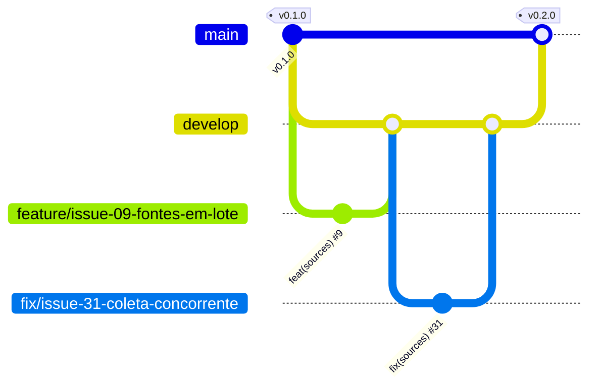

<p align="center">
  
</p>

# JobFly

> Idioma: **Português** | [English](README.en.md) | [Español](README.es.md)

[](https://github.com/thaynabds/JobFly/releases/tag/v0.2.0)
[](#licença)
[](https://github.com/thaynabds/JobFly/actions/workflows/ci.yml)
[](#qualidade-e-segurança)
[](src/jobfly-api)
[](src/jobfly-api)
[](src/jobfly-web)

**Plataforma de gestão de carreira e automação de candidaturas a vagas de emprego e estágio, no Brasil e no exterior.**

**Autora:** [Thayná Batista da Silva](https://github.com/thaynabds) · **Repositório:** privado · **Versão:** 0.2.0

## O problema

Quem procura emprego em tecnologia se candidata por muitos canais ao mesmo tempo: LinkedIn, Gupy, Greenhouse, sites de empresas, publicações no Instagram, grupos do Facebook, e-mail e indicação. Cada canal avisa (ou não) o andamento de um jeito. O resultado é vaga compatível passando despercebida, processo esquecido e candidatura feita sem entender os requisitos.

O JobFly junta tudo numa central única e explicável:
- **vigia** sites, ATS e redes sociais, vários de uma vez e para vários perfis;
- **analisa** a compatibilidade de cada vaga com cada perfil, mostrando o motivo de cada requisito;
- **acompanha** todas as candidaturas, de qualquer origem, pela evidência;
- **mostra** o que depende de você.

## Funcionalidades

### Implementado (v0.2.0)

| Área | O que faz |
|---|---|
| Contas | Cadastro e login com Argon2id, sessão de 15 minutos renovada por refresh token rotativo (revoga tudo se for roubado), bloqueio após tentativas erradas |
| Perfis | Vários perfis independentes com competências (nível e anos), idiomas CEFR, histórico, modalidades, localidades, pretensão e restrições |
| Fontes vigiadas | Cadastro e edição **em lote**, cada fonte ligada a **um ou mais perfis**. **Coleta automática** pelas APIs públicas do Greenhouse, Lever, SmartRecruiters e Ashby, com agendador em segundo plano, recuo após falhas, histórico e uma coleta por vez. **Lembretes** para LinkedIn, Instagram, Facebook, Gupy e outras plataformas que não permitem coleta automática |
| Vagas | Cadastro manual ou por coleta, com deduplicação por URL canônica e por empresa, cargo e local. Tecnologias citadas na descrição viram requisitos |
| Compatibilidade | Nota de 0 a 100 com o motivo de cada requisito. Impedimentos eliminatórios (modalidade, cidade, idioma, senioridade) separados da nota. APPLY só com todos os obrigatórios atendidos. Escolha automática do melhor perfil |
| Candidaturas | Central de candidaturas de qualquer origem, com 19 etapas. Cada mudança tem origem, evidência e confiança. Dúvida vira sugestão. Silêncio nunca vira reprovação. Sem duplicatas |
| Painel web | Visão geral, central de pendências com ação direta, Kanban com filtros, detalhe com histórico, perfis, fontes e vagas, em português e inglês |
| Operação | Um comando sobe banco, API e painel, só em 127.0.0.1. Testes de fumaça e de coleta real. CI no GitHub Actions |

### Planejado

| Próximo | Descrição |
|---|---|
| Gmail e Outlook | OAuth com escopos mínimos, classificação de mensagens, vínculo com a candidatura e respostas autorizadas. Nunca apaga e-mails |
| Agentes de IA | Análise de perguntas eliminatórias, revisão da candidatura antes do envio e documentos personalizados só com dados reais |
| MCP e extensão | Servidor MCP com permissões controladas e extensão de navegador "Enviar ao JobFly" |
| Documentos | Currículos versionados, anexos e importação de histórico em CSV |

A situação de cada requisito está em [docs/requisitos.md](docs/requisitos.md) e a ordem das próximas entregas em [docs/roadmap.md](docs/roadmap.md).

## Documentação

| Documento | Conteúdo |
|---|---|
| [Termo de abertura](docs/project-charter.md) | Justificativa, visão, objetivos SMART, escopo, stakeholders e público-alvo |
| [Requisitos](docs/requisitos.md) | RFs e RNFs numerados e rastreáveis, e regras de negócio |
| [Casos de uso](docs/casos-de-uso.md) | Atores e fluxos principal, alternativos e de exceção |
| [Histórias de usuário](docs/user-stories.md) | Histórias com critérios de aceite em Gherkin |
| [Diagramas](docs/diagramas.md) | C4 (contexto, contêineres e componentes), classes, DER e máquina de estados |
| [Arquitetura](docs/arquitetura.md) | Decisões (ADRs) e justificativas |
| [Modelo de dados](docs/modelo-dados.md) | Tabelas, deduplicação, estados e retenção |
| [API](docs/api.md) | Referência da API REST v1 |
| [Segurança](docs/seguranca.md) | Modelo de ameaça, controles e testes |
| [Integrações](docs/integracoes.md) | O que cada plataforma permite e como |
| [Roadmap](docs/roadmap.md) | Situação e próximas entregas |
| [Estudo do JobCopilot](docs/referencias-jobcopilot/matriz-funcionalidades.md) | Matriz comparativa de funcionalidades |

## Como executar

Requisitos: **Java 21**, **Node 20.19+** e **PostgreSQL 14+** instalados. O PostgreSQL só precisa dos programas: não precisa de configuração nem de sudo.

```bash
# 1. Uma vez: cria um PostgreSQL só seu em data/postgres (127.0.0.1:5433)
#    e grava .env com senhas e segredo JWT aleatórios (permissão 600)
scripts/configurar-local.sh

# 2. Sobe banco, API e painel
scripts/iniciar.sh
```

Abra **http://127.0.0.1:5173**, crie sua conta e comece pelos perfis e pelas fontes vigiadas. Para parar tudo: `scripts/iniciar.sh parar`.

Verificações:

```bash
cd src/jobfly-api && ./mvnw verify        # testes da API e cobertura mínima de 80%
cd src/jobfly-web && npm run verify       # tipos, testes e build do painel
python3 scripts/testar-api.py             # fluxo completo contra a API rodando
python3 scripts/testar-coleta.py          # coleta real de um board público do Greenhouse
```

As variáveis de ambiente estão em [.env.example](.env.example). Para usar o PostgreSQL do sistema (porta 5432): `scripts/configurar-local.sh --sistema`.

## Arquitetura e estrutura

Monólito modular em Java 21 + Spring Boot 4.1 (PostgreSQL, Flyway) e painel em React 19 + TypeScript + Vite 7. Os módulos são separados por responsabilidade e podem virar serviços próprios quando houver motivo ([ADRs](docs/arquitetura.md)).

```
JobFly/
├── docs/                 documentação (charter, requisitos, casos de uso, histórias, diagramas...)
├── src/
│   ├── jobfly-api/       API REST (Spring Boot): identity, profiles, jobs, matching, applications, sources, dashboard
│   └── jobfly-web/       painel web (React + TypeScript)
├── scripts/              configuração, execução, testes de fumaça e verificadores
├── .github/workflows/    integração contínua
├── AGENTS.md             regras para agentes de código (OpenCode)
└── opencode.json         configuração restritiva do OpenCode
```

## Fluxo de branches (Git Flow)

| Branch | Para quê | Recebe de | Regra |
|---|---|---|---|
| `main` | Produção: só versões estáveis com tag | `develop`, por PR de release | Nunca recebe commit direto. Cada release ganha uma tag anotada SemVer (`v0.1.0`, `v0.2.0`) |
| `develop` | Integração do que está pronto | `feature/*` e `fix/*`, por PR | Todo PR referencia a issue com `Closes #N` |
| `feature/issue-NN-descricao` | Uma issue de funcionalidade, documentação ou ferramenta | sai da `develop` | Commits atômicos em Conventional Commits: `feat(sources): ... (#9)` |
| `fix/issue-NN-descricao` | Correção de um defeito registrado em issue | sai da `develop` | `fix(escopo): ... (#31)` |



O backlog completo está nas [issues do repositório](https://github.com/thaynabds/JobFly/issues).

## Qualidade e segurança

- **128 testes automatizados**: 108 na API (unitários e de integração com a aplicação completa) e 20 no painel. Mais 26 verificações do teste de fumaça e o teste de coleta real.
- **Cobertura:** o build falha abaixo de 80% de linhas nos módulos críticos. Hoje a cobertura geral é de 94,3%.
- **Segurança** ([detalhes](docs/seguranca.md)):
  - isolamento por usuário (recurso alheio responde 404);
  - Argon2id e refresh token rotativo com detecção de reuso;
  - proteção contra CSRF, XSS, SQL injection e SSRF;
  - limite de tentativas e de tamanho de requisição;
  - CSP no painel;
  - serviços só em 127.0.0.1;
  - segredos fora do Git;
  - 0 vulnerabilidades conhecidas nas dependências do painel (`npm audit`).

## Licença

Todos os direitos reservados. Repositório privado.
