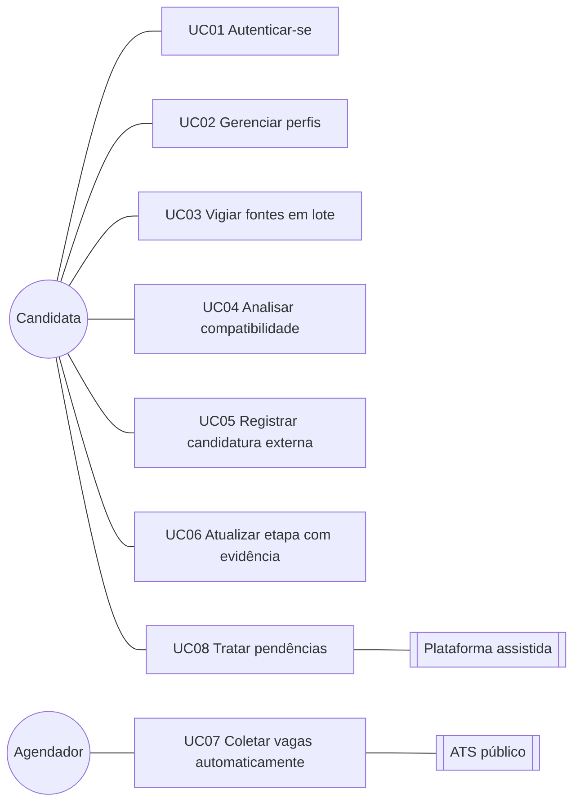

# Casos de uso do JobFly

Operações centrais da v0.2.0. Os identificadores [RFnn] remetem a [requisitos.md](requisitos.md).

## Atores

| Ator | Tipo | Descrição |
|---|---|---|
| Candidata | Primário, humano | Pessoa que procura emprego ou estágio e usa o painel. Dona dos próprios dados |
| Agendador | Primário, sistema | Processo em segundo plano da API que coleta as fontes automáticas na frequência configurada |
| ATS público | Secundário, sistema externo | Greenhouse, Lever, SmartRecruiters ou Ashby, que publicam vagas por API pública de leitura |
| Plataforma assistida | Secundário, sistema externo | LinkedIn, Instagram, Facebook, Gupy e outras que não permitem coleta automática: a candidata confere por conta própria |
| Provedor de e-mail | Secundário, sistema externo (planejado) | Gmail ou Outlook, por OAuth, na v0.3.0 |

---

## UC01 Autenticar-se

- **Ator:** Candidata. **Requisitos:** [RF01], [RNF01].
- **Pré-condição:** nenhuma.
- **Pós-condição:** sessão aberta, com token de acesso em memória e refresh token em cookie HttpOnly.

**Fluxo principal**
1. A candidata abre o painel e escolhe "Criar conta" (ou "Entrar").
2. Informa nome, e-mail e senha de pelo menos 12 caracteres.
3. O sistema grava a senha com Argon2id, abre a sessão e mostra a visão geral.

**Fluxos alternativos**
- A1. Ao reabrir o painel com sessão válida, o sistema renova a sessão pelo cookie sem pedir a senha.
- A2. A candidata troca o idioma para inglês na tela de entrada.

**Fluxos de exceção**
- E1. E-mail já cadastrado: o sistema responde que a conta já existe.
- E2. E-mail ou senha errados: mensagem genérica, igual para e-mail inexistente (não revela quem tem conta).
- E3. Cinco falhas seguidas: a conta fica bloqueada por 15 minutos.
- E4. Refresh token reapresentado depois de usado: o sistema revoga toda a família de sessões (indício de roubo).

## UC02 Gerenciar perfis profissionais

- **Ator:** Candidata. **Requisitos:** [RF02], [RF03], [RNF06].
- **Pré-condição:** sessão aberta.
- **Pós-condição:** perfil gravado e disponível para análise e fontes.

**Fluxo principal**
1. A candidata abre "Perfis" e escolhe "Novo perfil".
2. Preenche nome, senioridade, cargos desejados, localidades, modalidades, competências (nível e anos), idiomas e histórico.
3. Salva. O sistema valida, normaliza as competências (JS → javascript) e mostra o perfil.

**Fluxos alternativos**
- A1. Edição de um perfil existente: o sistema compara a versão e grava.
- A2. Exclusão: o perfil some das fontes ligadas e das análises.

**Fluxos de exceção**
- E1. Nome repetido ou competência repetida no mesmo perfil: o sistema recusa com a mensagem do motivo.
- E2. Link do histórico com esquema perigoso (`javascript:`): recusado.
- E3. Perfil editado em outra aba (versão desatualizada): o sistema recusa com 409 e pede para recarregar.

## UC03 Vigiar fontes em lote

- **Ator:** Candidata. **Requisitos:** [RF13], [RF14], [RF16].
- **Pré-condição:** sessão aberta. Perfis cadastrados, se ela quiser ligar as fontes a eles.
- **Pós-condição:** fontes gravadas, ligadas aos perfis, com a primeira coleta ou o primeiro lembrete agendados.

**Fluxo principal**
1. A candidata abre "Fontes vigiadas".
2. Preenche várias linhas: tipo (Greenhouse, LinkedIn, Instagram...), nome e board ou endereço.
3. Marca os perfis que usarão as fontes, escolhe a frequência e as palavras-chave.
4. Salva. O sistema cria todas as fontes de uma vez e informa quantas foram criadas e quantas já existiam.

**Fluxos alternativos**
- A1. Edição em lote: ela seleciona várias fontes e pausa, retoma, muda a frequência ou liga e desliga um perfil.
- A2. Fonte assistida vencida: aparece nas pendências com o link. Ela confere na plataforma e marca como conferida.
- A3. Fonte automática: ela pede "Coletar agora" (segue o UC07).

**Fluxos de exceção**
- E1. Identificador de board inválido (ex.: `../etc`) ou URL não http(s): o lote inteiro é recusado e nada é gravado.
- E2. Perfil de outra conta na lista: 404, e nada é gravado.
- E3. Fonte já vigiada (mesmo board ou mesma URL canônica): não é recriada e aparece entre as duplicadas.
- E4. Limite de 200 fontes por conta: recusado.

## UC04 Analisar compatibilidade de uma vaga

- **Ator:** Candidata. **Requisitos:** [RF04], [RF06], [RF07], [RF08].
- **Pré-condição:** vaga cadastrada ou coletada. Pelo menos um perfil.
- **Pós-condição:** análise exibida para todos os perfis, do mais para o menos adequado.

**Fluxo principal**
1. A candidata abre uma vaga.
2. O sistema avalia cada perfil: classifica cada requisito como atendido, parcial, não atendido ou "leitura humana", calcula a nota (70% obrigatórios e 30% desejáveis) e avalia os impedimentos.
3. Mostra a recomendação, a nota, os pontos fortes, os avisos e o motivo de cada requisito.
4. A candidata registra a candidatura com o perfil escolhido (segue o UC05).

**Fluxos alternativos**
- A1. Requisito sem competência informada: o sistema procura no texto uma competência do perfil, em qualquer grafia (C#, .NET, JS).
- A2. Vaga sem requisitos avaliáveis: recomendação "dados insuficientes", sem nota inventada.

**Fluxos de exceção**
- E1. Impedimento eliminatório (modalidade, cidade, idioma exigido, senioridade): recomendação "não recomendada", qualquer que seja a nota.
- E2. Obrigatório parcial ou sem avaliação automática: no máximo "revisar".
- E3. Vaga de outra conta: 404.

## UC05 Registrar candidatura externa

- **Ator:** Candidata. **Requisitos:** [RF05], [RF09].
- **Pré-condição:** sessão aberta.
- **Pós-condição:** candidatura na central, com o primeiro evento no histórico.

**Fluxo principal**
1. Em "Candidaturas", a candidata escolhe "Registrar candidatura externa".
2. Informa empresa, cargo, como se candidatou, plataforma, link, data, etapa e perfil.
3. O sistema grava com uma chave de idempotência e abre o detalhe da candidatura.

**Fluxos alternativos**
- A1. A partir de uma vaga do sistema (UC04): empresa, cargo e link vêm da vaga, e a nota de compatibilidade é calculada.
- A2. Sem data informada: a data de envio fica vazia (o sistema não inventa quando ela se candidatou).

**Fluxos de exceção**
- E1. Mesma URL, ou mesma empresa e cargo nos últimos 60 dias: o sistema devolve a existente e avisa.
- E2. Reenvio do mesmo formulário (mesma chave de idempotência): devolve o mesmo registro, sem duplicar.
- E3. Sem empresa ou cargo: recusado.

## UC06 Atualizar etapa com evidência

- **Ator:** Candidata (ou fonte automática no futuro). **Requisitos:** [RF10], [RF11], [RF12], [RF19].
- **Pré-condição:** candidatura existente.
- **Pós-condição:** evento no histórico e etapa atualizada (ou sugestão pendente).

**Fluxo principal**
1. No detalhe, a candidata escolhe a nova etapa, descreve a evidência e a próxima ação.
2. O sistema confere a transição, grava o evento (origem: você, confiança 100%) e atualiza a etapa.

**Fluxos alternativos**
- A1. Mesma etapa: o sistema só registra a evidência de que o processo segue vivo.
- A2. Fonte automática com confiança abaixo de 0,70: vira sugestão, e a candidata aceita ou descarta.
- A3. Anotação livre: fica no histórico sem contar como andamento.

**Fluxos de exceção**
- E1. Fonte automática tentando voltar etapa ou sair de estado final: recusado (409).
- E2. Data do acontecimento no futuro: recusada.
- E3. Sugestão já decidida, ou etapa mudada desde então: recusada ao aceitar.

## UC07 Coletar vagas automaticamente

- **Ator:** Agendador (ou Candidata, por "Coletar agora"). **Requisitos:** [RF15], [RNF03], [RNF11].
- **Pré-condição:** fonte automática ativa.
- **Pós-condição:** vagas novas gravadas e ligadas à fonte, recomendações criadas e execução no histórico.

**Fluxo principal**
1. O agendador encontra uma fonte vencida e reserva a execução.
2. Busca as vagas na API pública do ATS (host fixo, sem redirecionamento, limite de tempo e tamanho).
3. Filtra pelas palavras-chave da fonte ou pelos cargos dos perfis ligados.
4. Grava cada vaga sem duplicar, com as tecnologias citadas como requisitos mencionados.
5. Analisa com os perfis ligados e cria uma candidatura "Recomendada" quando o melhor perfil recomenda candidatura.
6. Registra a execução, libera a reserva e agenda a próxima.

**Fluxos alternativos**
- A1. Coleta manual pela candidata: mesmo fluxo, com resultado na tela.
- A2. Segunda coleta: as vagas já existentes não são recriadas.

**Fluxos de exceção**
- E1. ATS fora do ar, board inexistente ou resposta inválida: a falha é registrada, a próxima tentativa recua (até 24 h) e a fonte aparece nas pendências.
- E2. Coleta já em andamento: a segunda não roda (409 na manual).
- E3. Vaga com dados inválidos (ex.: URL não http): ignorada, sem derrubar a coleta.
- E4. Fonte assistida: não há coleta automática (409), só lembrete.

## UC08 Tratar pendências

- **Ator:** Candidata. **Requisitos:** [RF16], [RF17].
- **Pré-condição:** sessão aberta.
- **Pós-condição:** pendência resolvida ou encaminhada.

**Fluxo principal**
1. A candidata abre a visão geral.
2. O sistema lista as pendências por prioridade: ação dela, teste técnico, entrevista próxima, prazo, sugestão, fonte a conferir, integração com falha e sem atualização.
3. Ela age direto na lista: aceita ou descarta a sugestão, abre o link, marca a fonte como conferida ou abre a candidatura.

**Fluxos alternativos**
- A1. Nenhuma pendência: o sistema informa que está tudo em dia.
- A2. Painel em inglês: as frases do sistema aparecem em inglês, e o texto escrito por ela permanece como ela escreveu.

**Fluxos de exceção**
- E1. Ação falha (ex.: sugestão já decidida em outra aba): mensagem de erro e lista recarregada.
