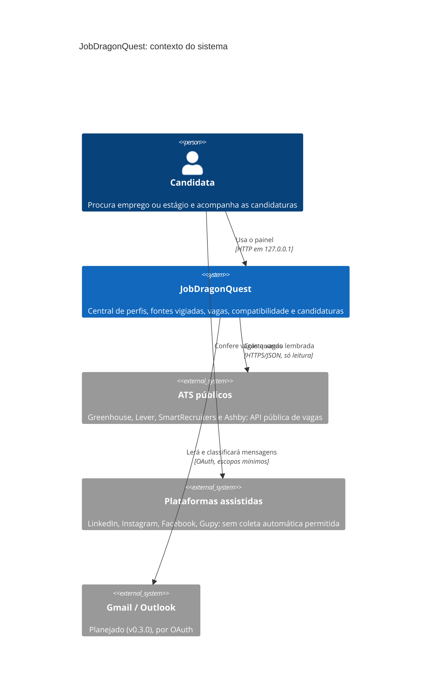
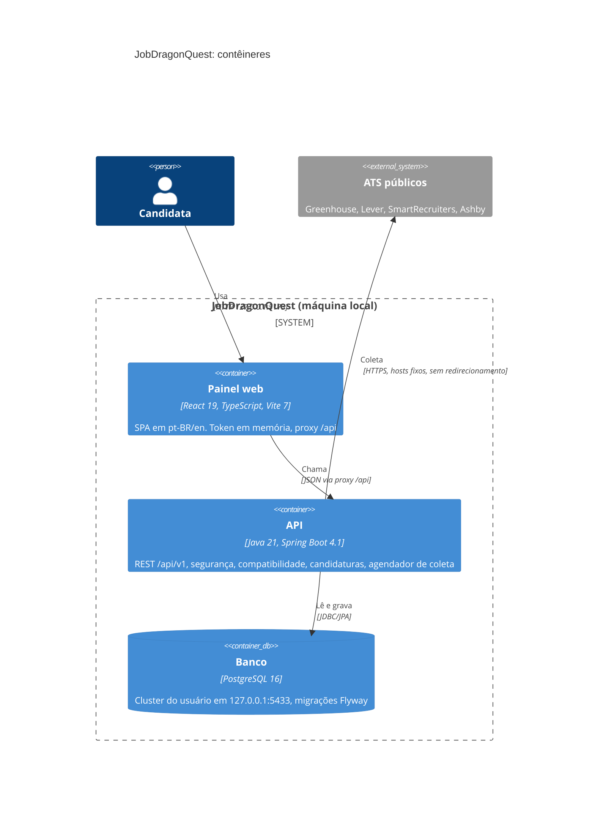
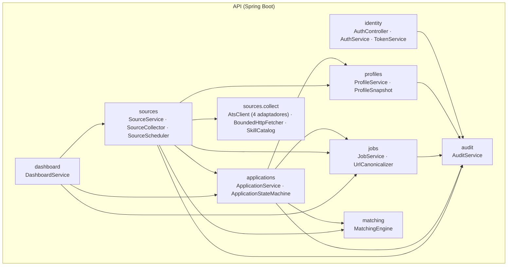
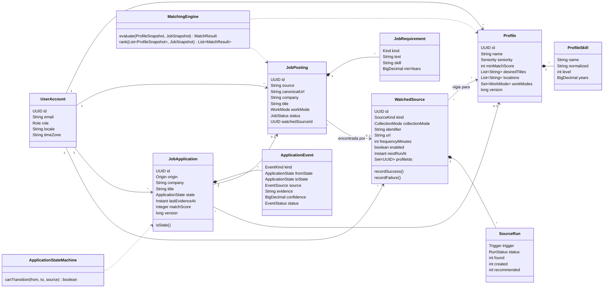
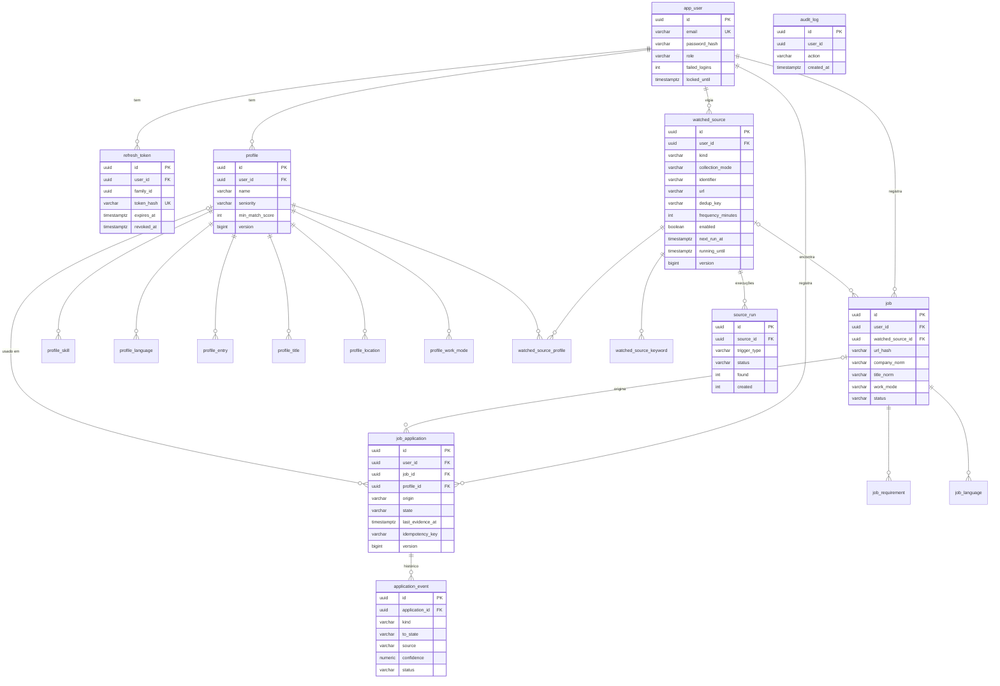
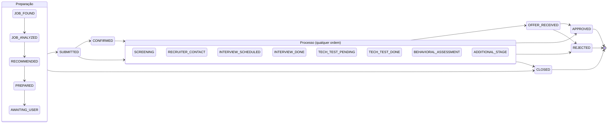

# Diagramas do JobDragonQuest

Diagramas em Mermaid, renderizados pelo GitHub. Eles refletem o código da v0.2.0 e as migrações Flyway V1 a V3.

## C4: nível 1, contexto

## C4: nível 2, contêineres

## C4: nível 3, componentes da API

## Diagrama de classes (domínio)

## Modelo entidade-relacionamento (DER)

## Máquina de estados da candidatura

Fontes automáticas (e-mail, portal, agente, sistema) só seguem as setas acima e nunca saem de um estado final. A candidata (fonte MANUAL) pode corrigir qualquer etapa, inclusive reabrir.
